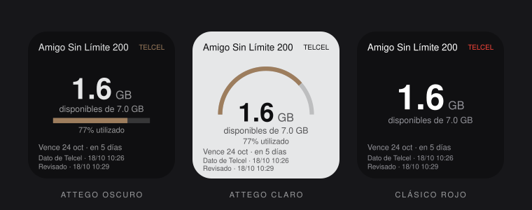

# Telcel Widget · por Attego

Un widget para la pantalla de inicio del iPhone que muestra cuántos datos te quedan en Telcel y cuándo vence tu paquete. Funciona con la app gratuita [Scriptable](https://scriptable.app), sin servidores: tu cuenta nunca sale de tu teléfono.



**[Crear mi widget →](https://gerardomange.github.io/telcel-widget/)** Elige colores, gráfica y fondo, y copia el código listo para pegar.

## Qué muestra

- Datos disponibles y total del paquete, en la unidad que da Telcel (MB o GB).
- Porcentaje utilizado, con barra, semicírculo o sin gráfica.
- Nombre del plan, fecha de vencimiento y días que faltan.
- La hora del dato de Telcel y la hora en que el widget lo revisó.
- Un aviso cuando no se pudo actualizar o cuando hay una versión nueva.

## Instalación

Necesitas un iPhone y tu cuenta de [Mi Telcel](https://www.mitelcel.com) (número y contraseña).

1. **Instala Scriptable** desde el [App Store](https://apps.apple.com/app/scriptable/id1405459188). Es gratis.
2. **Copia el código.** Abre el [generador](https://gerardomange.github.io/telcel-widget/) en tu iPhone, ajusta el diseño y toca **Copiar código**. Si prefieres el diseño por defecto, copia [widget/telcel.js](widget/telcel.js) completo.
3. **Pégalo en Scriptable.** Toca **+**, pega el código y ponle de nombre "Telcel".
4. **Guarda tu cuenta.** Toca ▶. Escribe tu número de 10 dígitos y tu contraseña de Mi Telcel. Verás el widget con tus datos.
5. **Agrégalo a la pantalla de inicio.** Mantén presionada la pantalla, toca **+**, busca Scriptable y elige el tamaño **pequeño**. Luego mantén presionado el widget, toca **Editar widget** y en **Script** elige "Telcel".

Desde ahí se actualiza solo. No tienes que volver a iniciar sesión.

## Cómo se actualiza

- El widget inicia sesión por ti en segundo plano, lee el consumo y cierra la sesión.
- **iOS decide cuándo refresca cada widget**, por lo general cada 15 a 30 minutos. No es en tiempo real.
- Para no saturar a Telcel, la lectura se guarda y se reutiliza durante 30 minutos (`cacheMinutes`).
- Si Telcel no responde, el widget muestra la última lectura con el aviso "No se pudo actualizar" y espera 15 minutos antes de reintentar.
- Telcel también registra el consumo con retraso. Por eso hay dos horas: **Dato de Telcel** (cuándo calculó Telcel el consumo) y **Revisado** (cuándo corrió el widget).

Para forzar una lectura nueva, abre el script en Scriptable, toca ▶ y elige **Actualizar ahora**.

## Menú del script

Al ejecutar el script a mano en Scriptable aparece un menú:

| Opción | Qué hace |
| --- | --- |
| Ver widget | Muestra el widget con la lectura guardada o una nueva si ya venció. |
| Actualizar ahora | Consulta a Telcel en ese momento. |
| Cambiar datos | Vuelve a pedir número y contraseña (por ejemplo, si cambiaste tu contraseña). |
| Personalizar u obtener nueva versión | Abre el generador con tu diseño actual ya cargado. |
| Borrar mis datos | Elimina tu cuenta y la lectura guardada del iPhone. |

## Personalizar

La forma fácil es el [generador](https://gerardomange.github.io/telcel-widget/): ves el resultado al momento y copias el código. Para cambiar el diseño de un widget ya instalado, genera el código de nuevo y reemplaza todo el script; tu cuenta guardada se conserva.

También puedes editar a mano el bloque `SETTINGS` al inicio del script:

| Opción | Valores | Por defecto |
| --- | --- | --- |
| `backgroundHex` | Color de fondo, seis dígitos hex | `0F0F11` (obsidiana) |
| `textPrimaryHex` | Cifra y nombre del plan | `E6E7E8` (hueso) |
| `textSecondaryHex` | Detalles y pista de la gráfica | `99999B` |
| `accentHex` | Gráfica y rótulo TELCEL | `9D7D5D` (bronce) |
| `chartStyle` | `bar`, `arc` o `none` | `bar` |
| `barCorners` | `square` o `round` | `square` |
| `font` | `helvetica` o `system` | `helvetica` |
| `showPlanName` | `true` o `false` | `true` |
| `backgroundImageUrl` | Enlace `https` de una imagen, o vacío | vacío |
| `backgroundOverlayOpacity` | De `0` a `1`: capa del color de fondo sobre la imagen | `0.55` |
| `cacheMinutes` | Minutos entre consultas a Telcel | `30` |
| `retryMinutes` | Espera después de un fallo | `15` |
| `debug` | `true` escribe un registro en la consola de Scriptable | `false` |
| `useSampleData` | `true` muestra datos de ejemplo sin consultar a Telcel | `false` |
| `sampleState` | `success`, `stale`, `error`, `setup`, `update` | `success` |

### Temas incluidos

| Tema | Fondo | Texto | Secundario | Acento |
| --- | --- | --- | --- | --- |
| Attego oscuro (por defecto) | `0F0F11` | `E6E7E8` | `99999B` | `9D7D5D` |
| Attego claro | `E6E7E8` | `0F0F11` | `545456` | `9D7D5D` |
| Clásico rojo | `101012` | `FFFFFF` | `929298` | `FF453A` |

El diseño por defecto sigue el sistema de diseño de Attego: obsidiana, hueso y un solo acento bronce; títulos en Medium, cifras en Bold y esquinas rectas. Si el color de acento no contrasta lo suficiente con el fondo (como el bronce sobre hueso), el rótulo TELCEL usa el color del texto principal para que se lea.

## Privacidad y seguridad

- Tu número y contraseña se guardan solo en el **Keychain de iOS** de tu iPhone. No están en el código ni en ningún servidor de este proyecto.
- El script se conecta únicamente a los servicios de Telcel y, una vez al día, lee [version.json](version.json) de este repositorio para avisar si hay una versión nueva. Esa consulta no envía ningún dato tuyo.
- Si pones una imagen de fondo, el widget la descarga del enlace que tú indiques.
- El registro de depuración (`debug`) nunca escribe tu número, contraseña ni tokens.
- Todo el código está en [widget/telcel.js](widget/telcel.js). Léelo antes de usarlo.

## Si algo falla

| Lo que ves | Qué hacer |
| --- | --- |
| "Configura tu cuenta" | Abre el script en Scriptable, toca ▶ y guarda tu número y contraseña. |
| "Telcel no aceptó el número o la contraseña" | Confirma que puedes entrar a [mitelcel.com](https://www.mitelcel.com) con esos datos y elige **Cambiar datos**. |
| "No se pudo actualizar" | Es normal de vez en cuando. El widget reintenta solo a los 15 minutos. |
| "No se pudo cargar" durante horas | Activa `debug: true`, ejecuta el script y revisa la consola de Scriptable. Si el código de error se repite, [abre un issue](https://github.com/gerardomange/telcel-widget/issues) con ese código (sin datos de tu cuenta). |
| El widget no cambia | iOS decide cuándo refrescarlo. Ejecuta el script y elige **Actualizar ahora**. |
| "Nueva versión disponible" | Toca el widget, copia el código nuevo y reemplaza todo el script. |

Este proyecto usa las mismas direcciones que la página de Mi Telcel. No son públicas ni están documentadas, así que Telcel puede cambiarlas sin aviso y el widget dejaría de funcionar hasta que se actualice.

## Desarrollo

No hay dependencias. Con [Node.js](https://nodejs.org) 22 o más reciente:

```bash
npm test
```

```bash
npm start
```

`npm test` ejecuta el script en un Scriptable simulado (lectura de la respuesta de Telcel, lecturas guardadas, reintentos, menú, temas y generador). `npm start` abre el generador en `http://localhost:4173`.

| Ruta | Contenido |
| --- | --- |
| `widget/telcel.js` | El script que se pega en Scriptable. |
| `index.html`, `generator.js` | El generador visual, publicado con GitHub Pages. |
| `version.json` | Versión publicada, para el aviso de actualización. |
| `tests/` | Pruebas y simulación de Scriptable. |
| `assets/` | Logotipos de Attego e imagen de vista previa. |

Para publicar una versión nueva, cambia `WIDGET_VERSION` en `widget/telcel.js` y el mismo número en `version.json`.

## Créditos y licencia

La conexión con Telcel (inicio de sesión, lectura del consumo y cierre de sesión) está basada en [mobile-data-tracker](https://github.com/gabri3l0/mobile-data-tracker) de Gabriel Soto, publicado con licencia MIT. Gracias por abrir el camino.

El código se publica con [licencia MIT](LICENSE). El nombre y los logotipos de Attego en `assets/` son marca de Attego y no forman parte de esa licencia.

Proyecto no oficial: no está afiliado, respaldado ni patrocinado por Telcel. Úsalo solo con tu propia cuenta y bajo tu responsabilidad.
